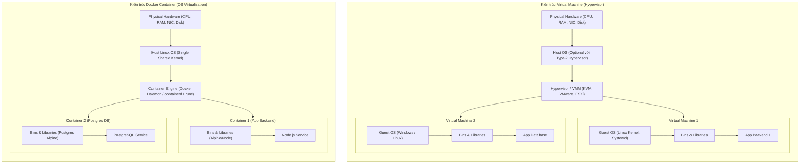

# BÁO CÁO KỸ THUẬT: PHÂN TÍCH KIẾN TRÚC CONTAINER VS VIRTUAL MACHINE (VM)
**Họ và tên:** Đào Trọng Trí  
**Mã sinh viên:** PTIT062  
**Học phần:** Thực hành DevOps / Cloud Native  
**Bài tập:** Session 10 - Bài 1  

---

## 1. Bối cảnh và Lý do Doanh nghiệp Dịch chuyển từ VPS (Virtual Private Server) sang Docker Container

Trong mô hình kiến trúc hạ tầng truyền thống, các doanh nghiệp thường thuê hoặc tự vận hành các máy chủ ảo VPS (Virtual Private Server) chạy trên nền tảng Hypervisor (như VMware ESXi, KVM, Xen, Proxmox). Mỗi VPS đóng vai trò như một máy chủ độc lập với toàn bộ hệ điều hành Guest OS, hạt nhân (kernel), trình điều khiển phần cứng ảo và các tiến trình nền của hệ thống.

Tuy nhiên, với sự bùng nổ của kiến trúc Microservices và phương pháp luận DevOps/CI-CD, mô hình VPS bộc lộ nhiều điểm nghẽn nghiêm trọng:
1. **Lãng phí tài nguyên (Resource Overhead):** Mỗi VPS đòi hỏi cấp phát trước dung lượng RAM, CPU và ổ đĩa cho Guest OS (thường tiêu tốn từ 1GB đến 4GB RAM chỉ để duy trì hệ thống chạy nền) ngay cả khi ứng dụng chưa xử lý tải.
2. **Thời gian khởi động chậm (Slow Startup Time):** Việc khởi động lại hoặc tạo mới một VPS mất từ 1 đến 5 phút do phải trải qua chu trình nạp BIOS ảo, Kernel boot và khởi chạy systemd/init. Điều này cản trở khả năng tự động co giãn (Auto-scaling) khi lưu lượng truy cập tăng đột biến.
3. **Hiện tượng "It works on my machine":** Cấu hình môi trường (OS library, runtime dependency, system packages) giữa máy lập trình viên (Development), máy kiểm thử (Staging) và máy chủ VPS Production thường xuyên bị sai lệch (Configuration Drift).
4. **Chi phí vận hành và bản quyền cao:** Chi phí duy trì số lượng lớn VPS kèm theo gánh nặng vá lỗi bảo mật (Patching), cập nhật kernel định kỳ cho từng máy ảo.

Chuyển đổi sang **Docker Container** (Ảo hóa mức Hệ điều hành - OS-level Virtualization) là giải pháp chiến lược giúp doanh nghiệp:
- Tối ưu hóa mật độ ứng dụng trên cùng một máy chủ vật lý (tăng gấp 4 - 10 lần so với VM).
- Khởi động ứng dụng trong vài mili-giây đến vài giây.
- Đóng gói toàn bộ code và runtime dependencies thành một Docker Image bất biến (Immutable Artifact), giải quyết triệt để sự không đồng nhất môi trường.
- Tự động hóa hoàn toàn quy trình CI/CD và sẵn sàng tích hợp vào các hệ thống điều phối container quy mô lớn (Kubernetes, Docker Swarm).

---

## 2. So sánh Kiến trúc: Hypervisor (VM) vs Docker Engine (Container)

### 2.1. Sơ đồ kiến trúc so sánh



### 2.2. Bảng so sánh chi tiết theo 5 tiêu chí cốt lõi

| Tiêu chí so sánh | Máy ảo (Virtual Machine / VPS) | Docker Container | Phân tích kỹ thuật chuyên sâu |
| :--- | :--- | :--- | :--- |
| **1. Dung lượng Image** | Rất lớn (Hàng GB đến hàng chục GB: 5GB - 30GB) | Siêu nhẹ (Hàng chục MB đến vài trăm MB: 5MB - 300MB) | VM phải chứa toàn bộ file hệ thống của Guest OS, swap partition, system binaries. Container chỉ chứa base filesystem tối thiểu và dependencies ứng dụng (ví dụ Alpine Linux chỉ ~5MB). |
| **2. Thời gian khởi động** | Chậm (Từ 30 giây đến vài phút) | Gần như tức thì (Vài trăm mili-giây đến 2 giây) | VM phải trải qua quy trình khởi động phần cứng ảo (BIOS, GRUB bootloader, nạp Kernel vào bộ nhớ và khởi động init/systemd). Container chỉ đơn thuần là một tiến trình con khởi tạo trên Host Kernel hiện có. |
| **3. Hao phí OS (OS Overhead)** | Rất cao (Mỗi VM tiêu tốn riêng 1-2GB RAM và CPU cycles cho Guest OS) | Gần như bằng 0 (Zero-overhead, chia sẻ chung Host Kernel) | Không có hypervisor translation layer; không tốn bộ nhớ để chạy các dịch vụ hệ thống trùng lặp. Toàn bộ tài nguyên phần cứng được dồn trực tiếp cho logic nghiệp vụ. |
| **4. Mức độ cô lập (Isolation)** | Tuyệt đối / Mức phần cứng (Hardware-level Isolation) | Mức tiến trình hệ điều hành (Process-level Isolation) | VM an toàn hơn do được phân tách bởi ranh giới phần cứng ảo hóa và Hypervisor; lỗ hổng trong một VM khó lan sang VM khác. Container cô lập bằng Linux kernel features (Namespaces, cgroups); nếu Kernel bị khai thác zero-day, rủi ro có thể ảnh hưởng diện rộng hơn. |
| **5. Khả năng mở rộng (Scalability)** | Kém linh hoạt, scaling chậm và tốn chi phí | Cực kỳ linh hoạt, hỗ trợ Auto-scaling tức thời | Tạo 100 máy ảo đòi hỏi hạ tầng máy chủ khổng lồ và mất hàng chục phút. Tạo 100 container chỉ mất vài chục giây và có thể đóng gói mật độ cao trên một máy chủ vật lý duy nhất. |

---

## 3. Cơ chế Cô lập Kernel (Namespaces) và Quản lý Tài nguyên (Control Groups - cgroups)

Bản chất của một Container không phải là một "máy ảo thu nhỏ", mà là **một tiến trình Linux tiêu chuẩn (Standard Linux Process)** được áp đặt hai cơ chế cốt lõi của Linux Kernel:

### 3.1. Linux Namespaces (Cơ chế Phân vùng và Cô lập Tầm nhìn)
Namespaces chia sẻ tài nguyên kernel nhưng tạo ra một "ảo ảnh không gian riêng biệt" cho tiến trình bên trong container, khiến nó tin rằng mình là hệ thống độc lập:

1. **PID Namespace (Process ID):**
   - Cô lập không gian cây tiến trình.
   - Tiến trình chính của ứng dụng bên trong container có PID = 1, có thể quản lý các tiến trình con nội bộ mà không nhìn thấy hay can thiệp vào các tiến trình của Host OS hay các container khác.
   - Trên Host OS, tiến trình này vẫn có một PID thực tế thông thường.
2. **NET Namespace (Network):**
   - Cung cấp giao diện mạng ảo (veth pair), bảng định tuyến (routing table), dải địa chỉ IP riêng và danh sách cổng mạng (port space) riêng biệt cho mỗi container.
   - Cho phép hai container trên cùng một máy chủ đều có thể lắng nghe trên cổng 80 hoặc 3000 mà không xung đột xung quanh.
3. **MNT Namespace (Mount Points):**
   - Cung cấp hệ thống tệp riêng biệt (root filesystem).
   - Container có thể mount hoặc unmount hệ thống tệp riêng mà không ảnh hưởng tới cây thư mục của Host OS.
4. **UTS Namespace (UNIX Timesharing System):**
   - Cho phép container sở hữu Hostname và Domain name độc lập.
5. **IPC Namespace (Inter-Process Communication):**
   - Ngăn cách các cơ chế giao tiếp giữa các tiến trình như System V IPC, POSIX message queues và shared memory.
6. **USER Namespace:**
   - Ánh xạ User ID và Group ID bên trong container sang UID/GID khác trên Host. Nhờ đó, người dùng `root` (UID 0) bên trong container có thể chỉ là một user không đặc quyền trên Host OS, tăng cường an ninh.

### 3.2. Control Groups - cgroups (Cơ chế Đo lường và Giới hạn Tài nguyên)
Nếu Namespaces quyết định **"Container nhìn thấy những gì"**, thì cgroups quyết định **"Container được phép sử dụng bao nhiêu tài nguyên"**:

- **Giới hạn CPU (CPU Quota & Shares):** Ngăn chặn một container bị vòng lặp vô tận (infinite loop) chiếm dụng toàn bộ 100% CPU của máy chủ, đảm bảo các container lân cận không bị "chết đói" tài nguyên (Noisy Neighbor problem).
- **Giới hạn Bộ nhớ (RAM Memory Limits):** Đặt ngưỡng tối đa (ví dụ `--memory="512m"`). Nếu container vượt quá ngưỡng, cơ chế Linux OOM (Out Of Memory) Killer sẽ can thiệp để bảo vệ an toàn cho Host OS.
- **Giới hạn I/O ổ đĩa (Blkio):** Giới hạn tốc độ đọc/ghi dữ liệu (Read/Write IOPS hoặc throughput) trên ổ đĩa vật lý.
- **Cgroups v2:** Phiên bản cgroup thế hệ mới thống nhất cây cấu trúc phân cấp (Single Hierarchy), quản lý tài nguyên đồng nhất và hỗ trợ kiểm soát áp lực tài nguyên (Pressure Stall Information - PSI) ưu việt hơn cgroups v1.

---

## 4. Trích xuất Thông số Thực tế từ Đầu ra Lệnh `docker info`

Lệnh `docker info` và `docker version` được thực thi trực tiếp trên máy chủ bằng tài khoản người dùng thường không dùng quyền `sudo` (nhờ đã được cấu hình vào group `docker` hợp lệ).

### 4.1. Bảng trích xuất các thông số cơ bản

| Thông số (Parameter) | Giá trị trích xuất thực tế | Ý nghĩa kỹ thuật |
| :--- | :--- | :--- |
| **Server Version** | `29.8.0` | Phiên bản Docker Engine Daemon đang hoạt động trên hệ thống. |
| **Storage Driver** | `overlayfs` (io.containerd.snapshotter.v1) | Trình điều khiển lưu trữ phân lớp (Copy-on-Write) tối ưu hóa hiệu năng I/O. |
| **Cgroup Driver** | `systemd` | Docker sử dụng `systemd` làm trình quản lý cgroup để đồng bộ với init system của hệ điều hành. |
| **Cgroup Version** | `2` | Hệ thống đang sử dụng Linux Cgroups v2 hiện đại nhất. |
| **Số lượng Containers** | `1` (Running: 0, Paused: 0, Stopped: 1) | Tổng số container trên máy chủ tại thời điểm kiểm tra. |
| **Số lượng Images** | `6` | Tổng số Docker Image đã tải về hoặc build trong local registry. |
| **Operating System** | `Ubuntu Core 24` | Hệ điều hành Host OS chạy nền tảng Docker. |
| **Kernel Version** | `6.8.0-146-generic` | Phiên bản nhân Linux Kernel dùng chung cho toàn bộ Container. |
| **Architecture** | `x86_64` | Kiến trúc CPU 64-bit của máy chủ. |
| **CPUs & Memory** | `2 CPUs` / `3.777 GiB` | Năng lực phần cứng vật lý/ảo hóa cấp phát cho máy chủ. |
| **Compose Plugin** | `v5.5.1` (Docker Compose CLI v2) | Tiện ích điều phối đa dịch vụ tích hợp sẵn trong Docker CLI. |

---

## 5. Nhật ký Lệnh Thực thi từ Terminal (Real Terminal Outputs)

### 5.1. Đầu ra lệnh `docker version`
```text
Client:
 Version:           29.8.0
 API version:       1.56
 Go version:        go1.26.7
 Git commit:        88096ef
 Built:             Fri Sep 11 09:11:15 2026
 OS/Arch:           linux/amd64
 Context:           default

Server:
 Engine:
  Version:          29.8.0
  API version:      1.56 (minimum version 1.40)
  Go version:       go1.26.7
  Git commit:       3ce5872
  Built:            Fri Sep 11 09:11:43 2026
  OS/Arch:          linux/amd64
  Experimental:     false
 containerd:
  Version:          v2.3.4
  GitCommit:        db8809540e1a7a9da5d518876894933ff55692ab
 runc:
  Version:          1.5.1
  GitCommit:        
 docker-init:
  Version:          0.19.0
  GitCommit:        de40ad0
```

### 5.2. Đầu ra lệnh `docker info`
```text
Client:
 Version:    29.8.0
 Context:    default
 Debug Mode: false
 Plugins:
  buildx: Docker Buildx (Docker Inc.)
    Version:  v0.37.0
    Path:     /usr/libexec/docker/cli-plugins/docker-buildx
  compose: Docker Compose (Docker Inc.)
    Version:  v5.5.1
    Path:     /usr/libexec/docker/cli-plugins/docker-compose

Server:
 Containers: 1
  Running: 0
  Paused: 0
  Stopped: 1
 Images: 6
 Server Version: 29.8.0
 Storage Driver: overlayfs
  driver-type: io.containerd.snapshotter.v1
 Logging Driver: json-file
 Cgroup Driver: systemd
 Cgroup Version: 2
 Plugins:
  Volume: local
  Network: bridge host ipvlan macvlan null overlay
  Log: awslogs fluentd gcplogs gelf journald json-file local splunk syslog
 CDI spec directories:
  /etc/cdi
  /var/run/cdi
 Swarm: inactive
 Runtimes: io.containerd.runc.v2 runc
 Default Runtime: runc
 Init Binary: docker-init
 containerd version: db8809540e1a7a9da5d518876894933ff55692ab
 runc version: 
 init version: de40ad0
 Security Options:
  apparmor
   Profile: default
  seccomp
   Profile: builtin
  cgroupns
 Kernel Version: 6.8.0-146-generic
 Operating System: Ubuntu Core 24
 OSType: linux
 Architecture: x86_64
 CPUs: 2
 Total Memory: 3.777GiB
 Name: 1037257148523321
 ID: 485b3784-f0c0-4cdc-a391-be26e105d60b
 Docker Root Dir: /var/snap/docker/common/var-lib-docker
 Debug Mode: false
 Experimental: false
 Insecure Registries:
  ::1/128
  127.0.0.0/8
 Live Restore Enabled: false
 Firewall Backend: iptables
  EnableUserlandProxy: true
  UserlandProxyPath: /snap/docker/3613/bin/docker-proxy
```

---

## 6. Hướng dẫn Chụp ảnh Minh chứng (Evidence Collection)

> **Hướng dẫn cho sinh viên:**
> 1. Mở cửa sổ Terminal và kết nối SSH vào máy chủ Linux:
>    ```bash
>    ssh devopsg5@103.72.57.148
>    ```
> 2. Chạy lệnh kiểm tra thông tin Docker Engine:
>    ```bash
>    docker info
>    ```
> 3. Sử dụng công cụ chụp ảnh màn hình (phím tắt `Command + Shift + 4` trên macOS hoặc `Windows + Shift + S` trên Windows) để chụp lại màn hình Terminal hiển thị đầy đủ lệnh và các thông số (Server Version, Cgroup Driver, Containers, Images).
> 4. Lưu ảnh và chèn vào vị trí placeholder `ImgEx` bên dưới.

### Minh chứng ảnh chụp:
`ImgEx: [Dán ảnh chụp màn hình terminal chạy lệnh docker info tại đây]`
